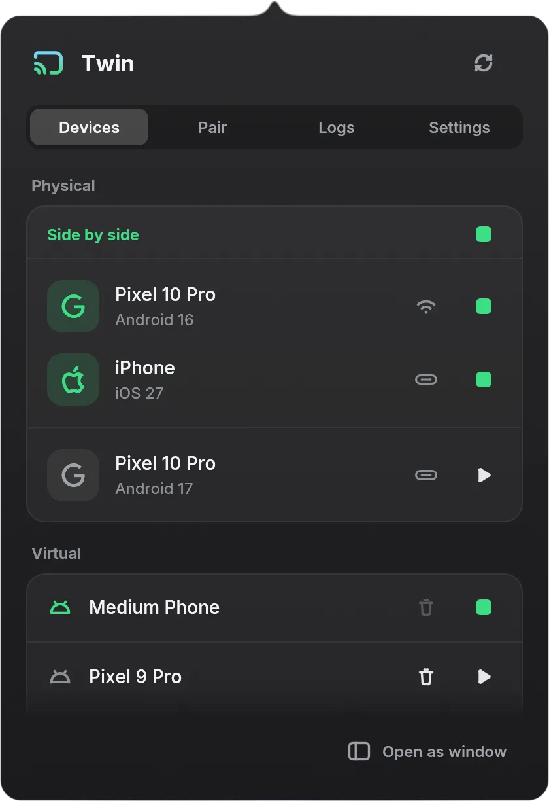

# Twin

Your Android phone and your iPhone on your Mac, one at a time or side by side in one
window, from a play button in the menu bar. Pair Android phones over Wi-Fi with a QR code,
mirror and drive them with your mouse and keyboard, and launch Android Virtual Devices,
without remembering SDK commands. Nothing is installed on either phone.

<p align="center">
  
</p>

- **Android:** Twin wraps Android's wireless debugging flow behind a QR code. Scan it
  with your phone and Twin handles mDNS discovery, `adb pair`, `adb connect`, and
  reconnects, then mirrors the phone with [scrcpy](https://github.com/Genymobile/scrcpy).
- **iPhone:** on iOS 27 with Developer Mode, Twin mirrors a USB-connected iPhone through
  the Device Hub services Xcode uses, so its screen keeps its real status bar and clicks,
  drags, scrolls and typing reach it live.
- **Side by side:** with both connected, one play button shows the two phones in one
  window that moves as one; each phone can also open or hide on its own.

Twin is the successor of [awb](https://github.com/ovitrif/awb) (Android Wifi Bridge). Its
settings carry over, and `awb` still runs the `twin` CLI. Twin runs on Apple silicon Macs;
the `twin` CLI also runs on Linux, for Android.

## Install

```sh
curl -fsSL https://github.com/ovitrif/twin/releases/latest/download/install.sh | sh
```

Pin a release or choose the install directory:

```sh
curl -fsSL https://github.com/ovitrif/twin/releases/latest/download/install.sh | \
  TWIN_INSTALL_TAG=vX.Y.Z TWIN_INSTALL_DIR="$HOME/.local/bin" sh
```

`install.sh` installs the `twin` CLI and, on macOS, `Twin.app` into /Applications.

Requirements: `adb` on your PATH (Android SDK platform-tools). `scrcpy` is optional and
only needed for screen mirroring. Launching AVDs requires the Android SDK Emulator;
deleting them requires Android SDK Command-Line Tools (`avdmanager`). The phone needs
Android 11+ with developer options enabled, on the same Wi-Fi network as your Mac. iPhone
mirroring needs Xcode 27 (for `devicectl`) and an iPhone on USB, on iOS 27+ with Developer
Mode on, that trusts this Mac.

## Menu bar app

```sh
twin app
```

Twin's icon appears in the menu bar. Left-click toggles the popover: a Devices tab
listing your phones (with one-click mirroring, side by side when Settings say so) and configured emulators, a Logs tab,
Settings, and QR pairing for new phones. Refresh, Settings, and Pair stay in the top-right
corner on every page. Each configured AVD stays listed while stopped, starting, or running.
Click the play icon to open its native Android Emulator window, or the trash icon to delete
a stopped AVD and its saved data after confirmation. Both actions are disabled while the
emulator is starting or running. Right-click (or control-click) offers Show, Pair, Refresh,
and Quit.

The popover works from the keyboard: Tab moves between controls, Return or Space activates
the focused one, Escape closes the popover, and ← / → step back and forward through the
pages you visited, then through Main, Settings, and Pair in order.

Twin.app holds the menu bar app and its mirrors: `Twin Mirror.app` (the iPhone and side by
side windows) and `Android Mirror.app` (the patched scrcpy) under `Contents/Helpers`.

## CLI

```sh
twin
```

Running `twin` with no arguments checks ADB, shows a QR code, and guides the phone from
`Developer options -> Wireless debugging -> Pair device with QR code` to a connected
device, with live waits, retries, and manual IP:port fallbacks when discovery misbehaves.
Once connected it offers to start scrcpy.

Useful commands and flags:

```sh
twin status --json       # ADB, scrcpy, Android phones and iPhones, for scripts and UIs
twin reset-adb           # kill and restart the local ADB server
twin completions zsh     # print zsh completions
twin app                 # launch the menu bar app
twin --connect-only      # pair and connect without the scrcpy menu
twin --background        # start scrcpy detached and exit
twin --foreground        # start scrcpy and wait until it exits
twin --stable            # scrcpy + keepalive watch + reconnects + Wi-Fi diagnostics
twin --watch --wifi-doctor
twin --timeout 120       # wait longer than the 60-second default
twin --device-serial SERIAL --background
twin --window-title "Android" --window-height 1071
twin --plain-window --always-on-top
twin --adb /path/to/adb --scrcpy /path/to/scrcpy
twin iphone status       # iPhones on USB
twin iphone mirror       # mirror the first one; --udid picks another
twin iphone devices --serial SERIAL   # that Android phone beside the iPhone
```

By default scrcpy launches borderless at 480x1071 with `--stay-awake` and no audio; pass
`--plain-window` for scrcpy's regular decorated window. The menu bar app stores its scrcpy
options in `~/.config/twin/config.toml`.

On Apple silicon, Twin prefers the scrcpy bundled in `Twin.app` (`Android Mirror.app`,
`tech.masivo.twin.android`). It is a pinned scrcpy release patched to draw a
QuickTime-style mirror window: rounded corners, a title bar with traffic lights while ⌘ is
held, and ⌘ + drag anywhere to move the window. It needs Homebrew's scrcpy dependencies;
without them, or without the app, Twin uses `scrcpy` from your PATH.

## iPhone mirroring

The iPhone's screen and touch travel over one Device Hub session through `dmb-hid`: an
H.265 stream of the screen and CoreDevice's HID service for touch, the services Xcode 27's
Device Hub uses. These are private, reverse-engineered services, so an iOS update can
break them. Before iOS 27 Twin falls back to QuickTime's capture path, view-only, which
asks once for camera access.

In the window:

- Click, drag and scroll to touch the phone; type to type into it.
- ⌘H goes home, ⌘L locks, ⌘B or right-click goes back on Android, ⌘W closes the mirror.
- Hold ⌘ to see the title bar; ⌘ + drag anywhere moves the window.
- Drag any edge of the phone's outline to resize; the window keeps the phone's aspect and
  turns with it.

## Build from source

```sh
git clone https://github.com/ovitrif/twin.git
cd twin
cargo build --release            # target/release/twin and target/release/twin-app
scripts/build-scrcpy.sh          # optional: patched scrcpy into target/scrcpy (needs meson, ninja, Homebrew ffmpeg, sdl3, libusb)
scripts/bundle-app.sh            # target/bundle/Twin.app, with Twin Mirror (needs Xcode) and the patched scrcpy
(cd apple && swift test)         # Twin Mirror's tests
```

The Rust workspace has three crates: `twin-core` (ADB, scrcpy, QR, and Bonjour logic),
`twin` (the CLI), and `twin-app` (the menu bar app, built from the design in `DESIGN.pen`).
`apple/` holds Twin Mirror, the Swift app that draws the iPhone and side by side windows,
its `dmb` helper CLI, and `apple/hid` (`dmb-hid`, on
[idevice](https://github.com/jkcoxson/idevice)), which carries the iPhone's screen and
touch. `scrcpy/macos-window.patch` holds the Android mirror window patch;
`scripts/build-scrcpy.sh` pins the scrcpy version and says how to move the patch to a new
release.

## License

MIT. Bundled [Inter](https://rsms.me/inter/) font is licensed under the SIL OFL 1.1;
icons are [Phosphor](https://phosphoricons.com/) (MIT); Twin's cast mark is
[theSVG](https://thesvg.org)'s Cast icon (MIT). scrcpy and its server are Apache-2.0.
